

  

  <a href="https://github.com/MrRobottos/Wired-Minds"></a>
  <a href="https://www.youtube.com/@BuildLikeARouge"></a>
  <a href="https://hackerone.com/prot3an"></a>

  

  <a href="https://www.youtube.com/@BuildLikeARouge"></a>

  
  
  

  

  

  
  
  

  

  

  <a href="https://github.com/MrRobottos/Wired-Minds"></a>

  

  

